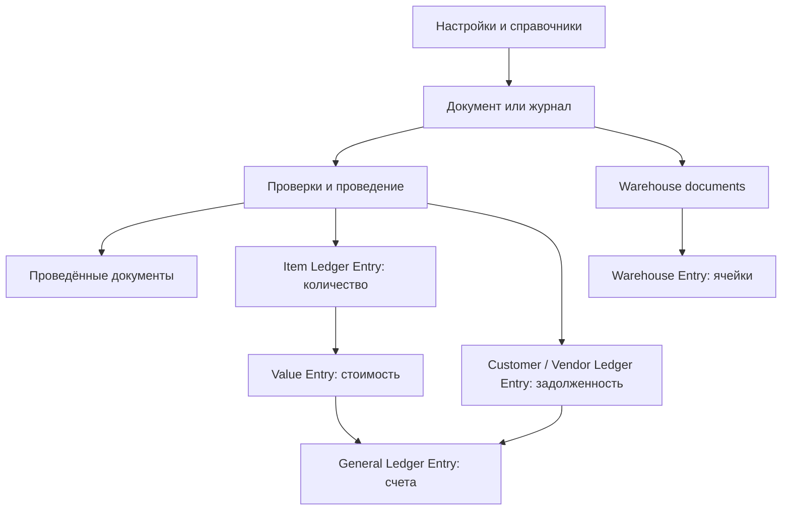

# 0.0. Как изучать Business Central

[К оглавлению](<Business Central and AL.md>) · [Далее: бухгалтерская основа](0.1-accounting-basics.md)

## 1. Что именно мы изучаем

Business Central объединяет работу пользователей и учёт её результатов. Продавец видит заказ, кладовщик — задание на отбор, бухгалтер — задолженность и счета, разработчик — таблицы и процедуры. Это разные представления одного процесса, но не одна и та же запись.

Для каждой операции задавайте пять вопросов:

1. Какой бизнес-факт произошёл: заказали, получили, отгрузили, выставили счёт, оплатили?
2. Какой документ разрешает или описывает действие?
3. Какие количества изменились и где?
4. Как изменилась стоимость, задолженность и бухгалтерия?
5. Какие записи доказывают результат и как они связаны?

Фраза «всё успешно проведено» говорит, что команда завершилась. Она не доказывает правильность даты, количества, партии, стоимости или счёта.

## 2. Главная карта системы



Схема показывает смысловые связи. Она не обещает, что каждая команда создаёт все записи одновременно. `Release` обычно не создаёт учётного движения, внутренний складской перенос не меняет запас по Location, перенос себестоимости в General Ledger может выполняться позже.

## 3. Учебная база и исходные условия

Для практики нужна отдельная учебная компания или sandbox. Пересоздавать существующий контейнер ради чтения курса не требуется.

| Что зафиксировать | Почему влияет на результат |
|---|---|
| Company | Одинаковые номера в разных компаниях означают разные документы |
| Application / platform version | Определяют доступные объекты и поведение |
| Localization | US Sales Tax и VAT локализации дают разные налоговые настройки |
| Work Date | Подставляется в новые документы и журналы |
| Posting Date | Определяет дату учётного события |
| Allowed posting dates | Могут запретить проведение или изменить дату adjustment |
| Item Type и Costing Method | Определяют складской и стоимостный учёт |
| Location setup | Определяет необходимость warehouse documents |
| Automatic Cost Adjustment / Posting | Определяют, что выполняется сразу |
| Item Tracking Code | Определяет требования к Lot / Serial |

Не выключайте настройки наугад ради прохождения упражнения. Для простого сценария используйте отдельный учебный Item и простую Location.

## 4. Сквозные обозначения

| Условный идентификатор | Назначение |
|---|---|
| `TRAIN-ITEM` | Inventory, FIFO, базовая единица PCS |
| `TRAIN-MAIN` | Простой склад без обязательных warehouse documents |
| `TRAIN-WH` | Склад для warehouse-упражнений |
| `TRAIN-CUST`, `TRAIN-VEND` | Покупатель и поставщик |
| `TRAIN-FG` | Готовое изделие |
| `TRAIN-C1`, `TRAIN-C2`, `TRAIN-C3` | Компоненты изделия |

Это не предустановленные записи CRONUS. Создайте их либо замените своими, сохранив условия опыта. Posting Groups берите из работающего примера вашей компании, затем изучайте, куда они ведут. Номера счетов из демонстрационной базы не универсальны.

## 5. Цикл одного упражнения

1. Зафиксируйте начальные остатки, документы, фильтры и настройки.
2. Напишите прогноз: например, «приход 10, расход 4, итог 6».
3. Выполните одно действие.
4. Найдите проведённый документ, запишите номер и дату.
5. Откройте связанные учётные записи.
6. Проверьте связи и суммы, используя Entry No. и ссылки на исходные записи.
7. Объясните расхождение, если оно появилось.

Путь по ленте может отличаться. Надёжный старт — `Alt+Q`, английское имя страницы, затем доступные действия. `Page Inspection` помогает узнать таблицу и поля, но её возможности зависят от доступа.

## 6. Как читать результат без ошибок

**Фильтр является частью доказательства.** Пять видимых строк не означают, что операция создала ровно пять строк. Проверьте дату, Location, Document No., Variant, Dimension и компанию.

**Document No. не заменяет связь.** Поздняя корректировка может иметь другую дату или документ. Найдите нужный Item Ledger Entry, затем все его Value Entries.

**Сумма важнее одной строки.** У расхода бывают первоначальная стоимость и несколько корректировок. Для итоговой actual cost суммируйте относящиеся к нему Cost Amount (Actual); expected cost анализируйте отдельно.

**Единицы должны совпадать.** При 1 BOX = 12 PCS поступление двух коробок означает 24 базовые единицы. Проверяйте Qty. per Unit of Measure и поля с `(Base)`.

**Остаток не равен доступности.** Наличие, доступность для продажи, picking и свободное от резервирования количество отвечают на разные вопросы.

## 7. Шаблон фиксации опыта

```text
Company:
Item No. / Variant Code:
Location Code / Bin Code:
Source document / posted document:
Posting Date:
Action performed:
Relevant settings:
Prediction:
Observed entries and Entry No.:
Quantity reconciliation:
Cost reconciliation:
Unexplained difference:
```

При ошибке сохраните полный текст и точное действие. Для AL добавьте call stack и версию приложения; пароли и токены в учебные заметки не включайте.

## 8. Важные границы формулировок

- «Учётные записи не редактируют» означает, что проведённый бизнес-факт не переписывают произвольно. Система обновляет служебные поля, применение, остатки и некоторые разрешённые атрибуты.
- Проведённый Receipt не означает, что Invoice тоже проведён.
- «Товар есть» без Location, Variant, tracking и единицы измерения — неполное утверждение.
- Работа под SUPER не доказывает корректность рабочих прав.
- Успешная компиляция не доказывает правильность бухгалтерского результата.

Модуль освоен, когда вы можете объяснить результат по записям, повторить его и назвать условие, которое изменит поведение. Вопросы в конце модулей служат самопроверке и не требуют останавливать чтение.

Официальная точка входа: [общие возможности Business Central](https://learn.microsoft.com/en-us/dynamics365/business-central/ui-across-business-areas).
