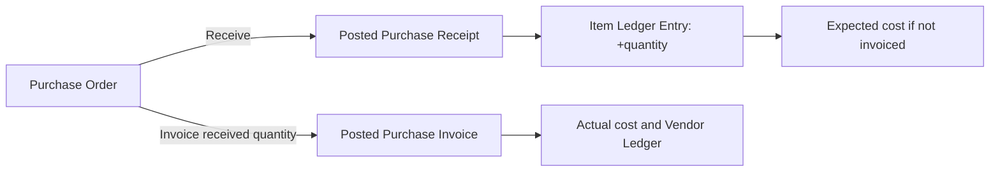

# 1.1. Запасы, документы и частичное проведение

[К оглавлению](<Business Central and AL.md>) · [Назад](1.0-what-bc-is.md) · [Далее: исправления](1.2-corrections-and-returns.md)

## 1. Три независимых вопроса

Когда товар движется, спрашивайте: сколько, на какую стоимость, отражено ли это на бухгалтерских счетах. Ответы находятся в разных наборах записей.

| Запись | Главное назначение | Важные поля |
|---|---|---|
| Item Ledger Entry | Количество по товару и Location | Entry No., Item No., Entry Type, Quantity, Remaining Quantity |
| Value Entry | Стоимость конкретного товарного движения либо других стоимостных объектов | Item Ledger Entry No., Cost Amount (Actual), Cost Amount (Expected), Adjustment |
| General Ledger Entry | Денежное отражение по счетам | G/L Account No., Posting Date, Amount |

Для обычного товарного движения один Item Ledger Entry может иметь несколько Value Entries. В производстве не каждая Value Entry обязательно связана с Item Ledger Entry: возможны capacity и order-level costs. [Inventory posting](https://learn.microsoft.com/en-us/dynamics365/business-central/design-details-inventory-posting).

## 2. Что означает Item Ledger Entry

Запись хранит факт увеличения или уменьшения запаса. Quantity обычно выражена в базовой единице товара. Bin Code в этой таблице не описывает расположение по ячейкам — для этого существует Warehouse Entry.

| Entry Type | Типичный знак Quantity | Смысл |
|---|---:|---|
| Purchase | + | Приход закупки; возврат поставщику даёт обратный знак |
| Sale | − | Расход продажи; возврат покупателя даёт обратный знак |
| Positive Adjmt. | + | Увеличение через корректировку |
| Negative Adjmt. | − | Уменьшение через корректировку |
| Transfer | + и − | Связанные движения между местами учёта |
| Consumption | − | Использование компонента |
| Output | + | Выпуск изделия |

Знак нужно читать вместе с типом. Положительный Sale может быть возвратом, а не новой отгрузкой.

### Quantity и Remaining Quantity

Quantity — первоначальное движение. Remaining Quantity — количество, которое ещё не применено к противоположным движениям. Приход +10 после расхода 4 сохраняет Quantity = 10, но его Remaining Quantity обычно становится 6. Именно поэтому фраза «в учётной записи никогда не меняется ни одно поле» неверна.

Открытый расход при отрицательном запасе может иметь отрицательное Remaining Quantity. Для Open важно наличие неприменённого количества, а не только условие «больше нуля».

## 3. Item Journal

Журнал подходит для начальных остатков и корректировок. Он не заменяет закупочный документ, если нужна задолженность поставщику.

Перед проведением проверьте Journal Template / Batch, Posting Date, Document No., Item No., Entry Type, Location, Quantity, Unit Amount и tracking.

Для обычного списания в Item Journal выберите Negative Adjmt. и введите **положительное** количество 3. В Item Ledger Entry результат будет −3. Не переносите знак учётной записи механически в поле журнала: отрицательное количество в сочетании с типом может обратить смысл операции.

Для перемещения и переклассификации используйте предназначенный для этого Item Reclassification Journal или Transfer Order, а не случайный набор положительных и отрицательных корректировок.

Практика: положительная корректировка 10 по 10, затем отрицательная 3. При отсутствии других движений ожидается 7 единиц, стоимость после окончательной обработки — 70. [Count, adjust, reclassify](https://learn.microsoft.com/en-us/dynamics365/business-central/inventory-how-count-adjust-reclassify).

## 4. Purchase Order: количество отдельно от invoice



Received означает физически принятое в учёте. Invoiced означает фактурированное. Эти величины могут различаться.

Упражнение: заказ 10 единиц.

| Состояние | Quantity | Quantity Received | Quantity Invoiced | Ещё не получено |
|---|---:|---:|---:|---:|
| До проведения | 10 | 0 | 0 | 10 |
| Receive 4 | 10 | 4 | 0 | 6 |
| Invoice 3 из полученных | 10 | 4 | 3 | 6 |
| Receive ещё 6 | 10 | 10 | 3 | 0 |
| Invoice оставшиеся 7 | 10 | 10 | 10 | 0 |

Qty. to Receive и Qty. to Invoice управляют **следующим** проведением. Они не являются историческими итогами. Автозаполнение после проведения зависит от настройки Default Qty. to Receive и процесса; не считайте конкретное автоматически предложенное число гарантией.

Invoice уже полученного количества не должен второй раз увеличивать запас. Если вместо получения строк существующего Receipt создать независимую Item-строку в новом Purchase Invoice, можно получить новый приход. Привязка к исходному получению принципиальна.

О закупках: [Record purchases](https://learn.microsoft.com/en-us/dynamics365/business-central/purchasing-how-record-purchases).

## 5. Sales Order

Ship создаёт физический расход и Posted Sales Shipment. Invoice создаёт расчёты с покупателем, выручку и фактурирование соответствующей стоимости. Ship and Invoice объединяет этапы одной командой.

```text
Заказано: 10
Отгружено: 4
Фактурировано: 3
Не отгружено: 6
Отгружено, но не фактурировано: 1
```

Последняя единица уже ушла со склада, хотя клиенту ещё не выставлен счёт на неё. По ней нельзя судить о долге только по количеству Shipment.

При отдельном Invoice уже отгруженных строк повторного количественного расхода не возникает. Standalone Sales Invoice с новой Item-строкой может провести и движение товара, и счёт; это другой сценарий. [Sell products](https://learn.microsoft.com/en-us/dynamics365/business-central/sales-how-sell-products).

## 6. Release и Reopen

Open позволяет работать с документом. Released означает, что документ подготовлен к последующим процессам; ряд изменений ограничен. Для редактирования обычно используют Reopen. Workflow может добавлять Pending Approval и другие состояния.

Release:

- не создаёт продажу сам по себе;
- не доказывает approval workflow, если такого процесса нет;
- не означает, что склад уже отобрал товар;
- не гарантирует успешное будущее проведение: доступность, даты или настройки могут измениться.

Не все поля Released-документа обязательно полностью заблокированы: разрешённые изменения определяются приложением. Для складских документов Release часто является условием получения source document. [Document status](https://learn.microsoft.com/en-us/dynamics365/business-central/ui-document-status).

## 7. Transfer Order

Перемещение не является продажей: собственник не меняется и выручка не возникает. В обычном двухэтапном варианте используются исходная Location, In-Transit Location и целевая Location.

| Этап для 3 единиц | Source | In-Transit | Destination | Всего |
|---|---:|---:|---:|---:|
| До перемещения | 3 | 0 | 0 | 3 |
| После Ship | 0 | 3 | 0 | 3 |
| После Receive | 0 | 0 | 3 | 3 |

Проверка только Source покажет «товар исчез», но общий запас компании сохранится. При частичном получении часть остаётся in transit.

Direct Transfer и прямое проведение — отдельные варианты с другими условиями. Не переносите таблицу выше на любой transfer без проверки настроек. [Transfer inventory](https://learn.microsoft.com/en-us/dynamics365/business-central/inventory-how-transfer-between-locations).

## 8. Item Charges

Дополнительные затраты, например доставка, можно распределить на поступление через Item Charge Assignment. Такая строка меняет стоимость без добавления физических единиц товара.

Пример: приобретено 10 единиц за 100, позднее назначена доставка 20. Итоговая стоимость партии — 120. Если четыре единицы уже проданы, после cost adjustment 8 из дополнительных 20 относятся к расходу, 12 — к оставшимся шести единицам, при простом FIFO-сценарии без других движений.

Метод распределения по сумме, количеству, весу и другим основаниям выбирают по смыслу затрат. Распределить расход и провести invoice — разные этапы. [Item charges](https://learn.microsoft.com/en-us/dynamics365/business-central/payables-how-assign-item-charges).

## 9. Drop Shipment и Special Order

Drop Shipment связывает закупку с продажей, когда поставщик доставляет прямо покупателю. Отсутствие физической обработки на вашем складе не означает отсутствия товарных и стоимостных учётных записей.

Special Order тоже связывает закупку с конкретным спросом, но обычно товар проходит через вашу обычную логистику. Эти режимы нельзя выбирать только ради обхода warehouse requirements. [Drop shipment](https://learn.microsoft.com/en-us/dynamics365/business-central/sales-how-drop-shipment).

## 10. Практический протокол

1. Создайте заказ на 10 TRAIN-ITEM по 10 в простой Location.
2. До Receive запишите остаток товара и состояние строки заказа.
3. Установите Qty. to Receive = 4 и проведите Receive.
4. Найдите Posted Purchase Receipt, Item Ledger Entry и все Value Entries.
5. Установите Qty. to Invoice = 4 и проведите Invoice полученного количества.
6. Сравните товарное количество до и после invoice: оно не должно второй раз вырасти.
7. Создайте Sales Order на 2, выполните Ship, затем Invoice.
8. Проверьте итог: начальный остаток +4 −2, независимо от числа стоимостных записей.

Для анализа сохраните Item No., Entry No., Entry Type, Quantity, Remaining Quantity, Invoiced Quantity, Location Code, Posting Date и связанные Value Entries.

## 11. Самопроверка

**Почему у одного движения несколько Value Entries?** Стоимость развивается во времени: получение, invoice, charges, adjustment.

**Почему invoice не всегда создаёт Item Ledger Entry?** Он может фактурировать уже существующее движение.

**Можно ли считать Quantity Received оплатой поставщику?** Нет: это получение товара, не расчёт деньгами.

**Почему после Transfer общий запас тот же?** Товар меняет место внутри компании.

**Что важнее сообщения об успехе?** Согласованные количества, стоимости и ссылки на проведённые записи.
