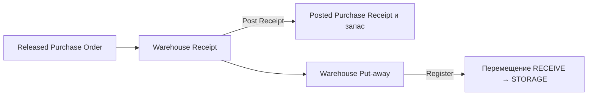
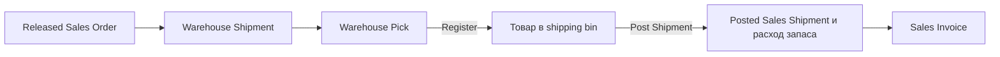

# 1.4. Locations, ячейки и складские процессы

[К оглавлению](<Business Central and AL.md>) · [Назад](1.3-costing-and-posting.md) · [Далее: производство](1.5-manufacturing.md)

## 1. Два уровня складского учёта

Item Ledger Entry отвечает, сколько товара находится на Location. Warehouse Entry объясняет движения между Bin внутри складского процесса.

```text
Location TRAIN-WH: всего 10
  Bin RECEIVE: 2
  Bin STORAGE: 5
  Bin SHIP:    3
```

Все десять ещё могут принадлежать запасу компании. Три единицы в SHIP уже отобраны, но это не доказывает проведённую отгрузку покупателю.

При переносе двух единиц STORAGE → SHIP меняются Warehouse Entries. Общий запас Location не меняется, поэтому новый Item Ledger Entry для обычного внутреннего движения не нужен.

## 2. Основные сущности

| Сущность | Роль |
|---|---|
| Location | Место учёта и настройки процесса |
| Bin | Ячейка внутри Location |
| Bin Content | Содержание ячейки по товару и другим измерениям |
| Zone | Группа ячеек в расширенном складе |
| Bin Type | Разрешённые складские функции ячейки |
| Warehouse Class | Совместимость товара и места хранения |
| Warehouse Employee | Связь пользователя с обслуживаемыми складами |

Fixed Bin сохраняет назначение товара ячейке и при нулевом остатке. Default Bin участвует в предложении места в соответствующей конфигурации. Dedicated Bin ограничивает обычный picking в пользу определённого назначения. Это разные признаки.

## 3. Уровень склада задаётся сочетанием флагов

| Конфигурация | Типичный процесс |
|---|---|
| Без обязательных warehouse documents | Receive / Ship из исходного заказа |
| Bin Mandatory | В движении обязательно указывают ячейку |
| Basic put-away / pick | Inventory Put-away / Inventory Pick для отдельных источников |
| Require Receive / Require Shipment | Warehouse Receipt / Warehouse Shipment |
| Directed Put-away and Pick | Управляемые размещение, отбор и правила ячеек |

Не считайте эту таблицу перечнем всех допустимых комбинаций. Флаги имеют зависимости, а часть настроек нельзя свободно менять при существующих запасах и документах.

**Тонкость:** Require Pick или Require Put-away сами по себе в basic setup не всегда запрещают прямое проведение исходного документа. Обязательный маршрут Warehouse Receipt / Shipment определяется соответствующими настройками и комбинацией процесса. [Warehouse setup](https://learn.microsoft.com/en-us/dynamics365/business-central/design-details-warehouse-setup).

## 4. Входящий поток расширенного склада



Смысл этапов:

1. Purchase Order описывает договорённость с поставщиком.
2. Warehouse Receipt объединяет фактическую приёмку, иногда по нескольким заказам.
3. Post Receipt отражает получение и создаёт необходимые товарные и складские записи.
4. Put-away задаёт работу по размещению.
5. Register Put-away подтверждает движение по ячейкам.

После Receipt товар может уже существовать в учётном запасе, но ещё не быть доступен для обычного picking из storage bin. Создание Put-away автоматически или отдельным действием зависит от настройки. [Receive items](https://learn.microsoft.com/en-us/dynamics365/business-central/warehouse-how-receive-items).

## 5. Исходящий поток



Register Pick обычно перемещает товар в отгрузочную ячейку и обновляет складской процесс. Post Shipment отражает расход с Location. Invoice отражает денежную часть.

Warehouse Shipment — рабочий документ склада, который может объединять источники. Posted Warehouse Shipment — история его проведения. Posted Sales Shipment — проведённый коммерческий документ отгрузки продажи. Их нельзя отождествлять по похожему названию. [Ship items](https://learn.microsoft.com/en-us/dynamics365/business-central/warehouse-how-ship-items).

## 6. Inventory Pick и Warehouse Pick

| Вопрос | Inventory Pick | Warehouse Pick |
|---|---|---|
| Контекст | Базовый склад | Более развитая warehouse-цепочка |
| Связь с исходным движением | Проведение может сразу провести исходную отгрузку/потребление | Регистрация обычно подтверждает складское перемещение |
| Следующий этап | Зависит от источника | Часто отдельно Post Warehouse Shipment |

Поэтому правило «любой Pick только перемещает между ячейками» неверно. Сначала прочитайте точное имя документа и действие: Post или Register.

## 7. Take, Place и количество к обработке

Один перенос может быть представлен парой строк:

| Action Type | Bin | Qty. to Handle |
|---|---|---:|
| Take | STORAGE | 3 |
| Place | SHIP | 3 |

В документе это две стороны одной работы. Нельзя сложить их и объявить, что отгрузили 6. Аналогично Warehouse Entries внутреннего переноса содержат уменьшение одной ячейки и увеличение другой.

При частичной работе изменяйте Qty. to Handle согласованно. Разделение по разным bins, lots или serials создаёт больше строк, не обязательно больше товара.

## 8. Почему запас есть, а Pick не создаётся

Проверьте:

1. Правильны ли Location и Variant?
2. Товар уже размещён или лежит в receiving bin?
3. Разрешён ли picking для Bin Type?
4. Не закреплён ли запас другим Pick или reservation?
5. Совпадают ли Lot / Serial, expiration и blocking?
6. Достаточно ли количества в правильной единице?
7. Released ли источник и осталась ли необработанная Quantity?
8. Не создан ли складской документ раньше?

Наличие по Item Card — агрегат. Алгоритм picking работает с более узкой доступностью. [Warehouse availability](https://learn.microsoft.com/en-us/dynamics365/business-central/design-details-warehouse-availability).

## 9. Warehouse Entry и сверка

Warehouse Entries позволяют восстановить перемещение по ячейкам; Warehouse Register группирует регистрацию. При современных механизмах конкурентного проведения нельзя полагаться на абсолютно непрерывный диапазон Entry No. для одной операции — учитывайте фактическую связь с register. [Creating warehouse entries](https://learn.microsoft.com/en-us/dynamics365/business-central/design-details-warehouse-entries).

Сверяйте:

```text
Остаток по Location в товарном учёте
↔ согласованное количество warehouse по той же Location,
  Item, Variant, tracking и базовой единице
```

В расширенном складе warehouse adjustment и товарный adjustment могут быть разными этапами с Adjustment Bin и Calculate Whse. Adjustment. Не дублируйте корректировку вручную на обоих уровнях без понимания связующего процесса.

## 10. Практика

На подготовленной TRAIN-WH получите 10 единиц, разместите 10, создайте продажу 3, зарегистрируйте Pick и затем проведите Shipment.

| Контрольная точка | Запас Location | Storage bin | Shipping bin |
|---|---:|---:|---:|
| После размещения | 10 | 10 | 0 |
| После Register Pick | 10 | 7 | 3 |
| После Post Shipment | 7 | 7 | 0 |

Условия: простое распределение по указанным bins, без других движений. На каждом этапе сравните Warehouse Entries и Item Ledger Entries.

## 11. Самопроверка

**Почему нельзя просто Ship из Sales Order?** Для выбранной Location может требоваться Warehouse Shipment, который координирует складскую работу.

**Register Pick всегда уменьшает запас Location?** Нет; в advanced flow обычно это внутреннее перемещение. Inventory Pick имеет иной процесс.

**Почему в Item Ledger Entry нет нужного Bin?** Эта таблица учитывает другой уровень; детали ячейки находятся в Warehouse Entries.

**Зачем Movement Worksheet?** Для организации и предложения внутренних перемещений; его можно изучать после базового receipt/pick/shipment.
